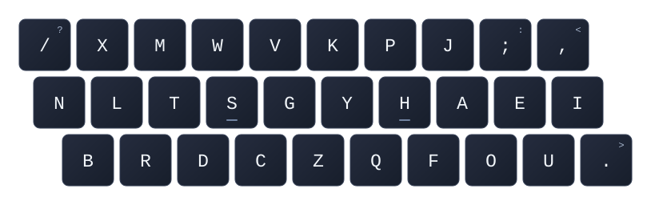
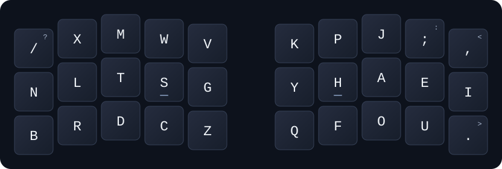
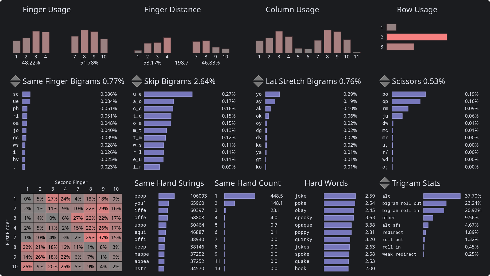
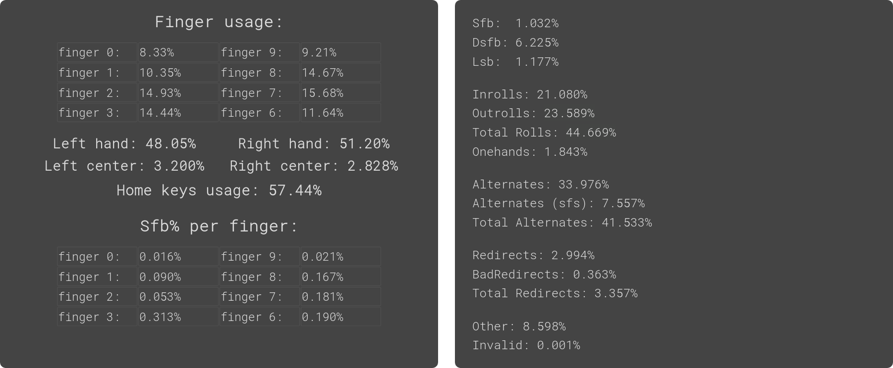

### About LTS

**Graphite-inspired:** LTS is a Graphite-inspired English keyboard layout that emphasizes bottom-row access and convenient Vim commands. It preserves Graphite's broad consonant/vowel organization and, under conventional touch-typing fingering, keeps 24 of the 26 letters on the same fingers while rearranging their row positions.

**Bottom-row priority:** Unlike Graphite and Gallium, LTS deliberately favors typing below the home row rather than above it. In [Peter Norvig's frequency-weighted English book corpus](https://norvig.com/mayzner.html), approximately 28% of letters fall on the bottom row and only 8% on the top row, compared with roughly 10% and 24% respectively for Graphite. This makes LTS an alternative for typists who prefer downward finger movements over upward reaches.

**Vim-focused:** The placement of `L` and `J` is tailored to Vim users. Swapping `L` and `R` puts rightward navigation on the home row, while moving the less frequently used replace-character command below it. Both letters remain on the same finger, preserving finger-based layout statistics. `J` moves from Graphite's upper pinky position to the right middle finger. `J` and `K` occupy the same row on different fingers, unlike Gallium, where both use the right index finger.

**Tradeoffs:** LTS makes deliberate tradeoffs rather than claiming universal improvement. Combinations such as `BR` and `RD` become same-row movements compared with Graphite, while `RM` spans both outer rows. Moving `J` introduces same-finger combinations with `A` and `O`, modestly increasing measured same-finger bigrams.

**Who it is for:** LTS is for people who appreciate Graphite's underlying structure but prefer bottom-row movements and Vim-conscious key placement.

**The name:** LTS refers both to the consecutive `L`, `T`, and `S` keys on the home row and to “Long Term Support” for your hands, reflecting its goal of reducing finger movement and promoting lasting typing comfort.

### Installation

Download this repository using **Code → Download ZIP**, extract it, and choose **one implementation per input context**:

| Target                        | Layout file                          | Setup and removal                |
| ----------------------------- | ------------------------------------ | -------------------------------- |
| Linux desktop                 | [XKB symbols](linux/xkb/symbols/lts) | [Guide](linux/xkb/README.md)     |
| Linux console / TTY           | [lts.map](linux/console/lts.map)     | [Guide](linux/console/README.md) |
| macOS native                  | [LTS.keylayout](macos/LTS.keylayout) | [Guide](macos/README.md)         |
| Windows native                | [lts.klc](windows/lts.klc)           | [Guide](windows/README.md)       |
| Kanata: Windows, Linux, macOS | [lts.kbd](kanata/lts.kbd)            | [Guide](kanata/README.md)        |
| AutoHotkey v2: Windows        | [lts.ahk](autohotkey/lts.ahk)        | [Guide](autohotkey/README.md)    |

All implementations use a **US-QWERTY baseline** and remap only the 30 positions above. Shift gives uppercase letters and the usual punctuation partners: `/?`, `;:`, `,<`, `.>`. Numbers, other punctuation, modifiers, navigation, and function keys retain the target platform's US behavior. Regular and split keyboards use the same mapping.

### Layout

```text
/  X  M  W  V    K  P  J  ;  ,
N  L  T  S  G    Y  H  A  E  I
B  R  D  C  Z    Q  F  O  U  .
```

### Regular keyboard



### Split keyboard



### [Cyanophage Layout Playground](https://cyanophage.github.io/playground.html)



### [Oxey's Layout Playground](https://oxey.dev/layouts/playground/)


